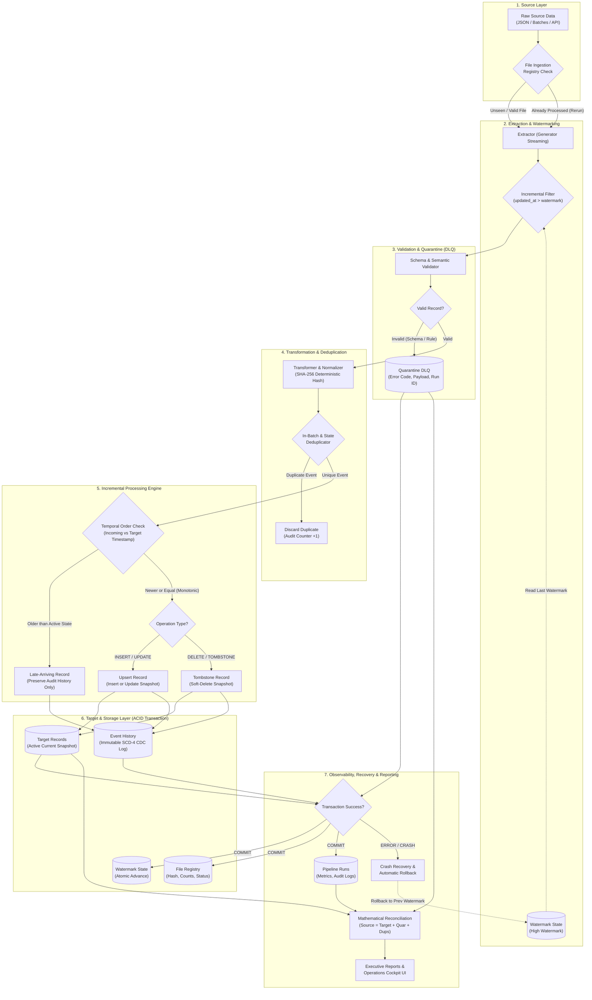
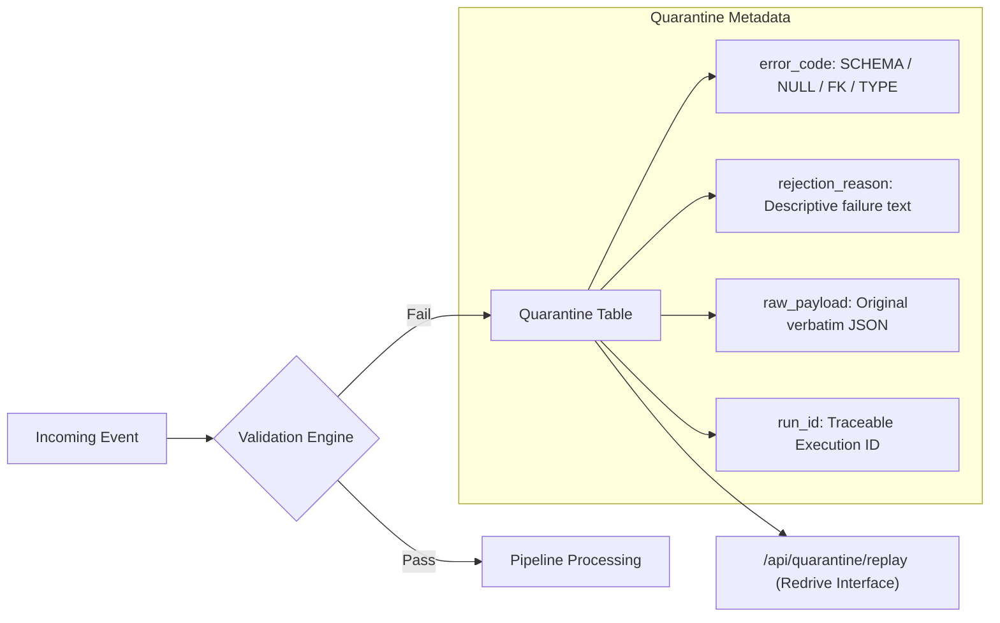
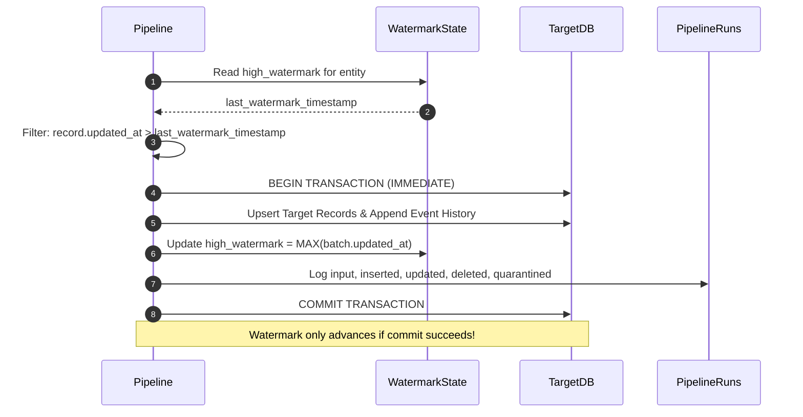
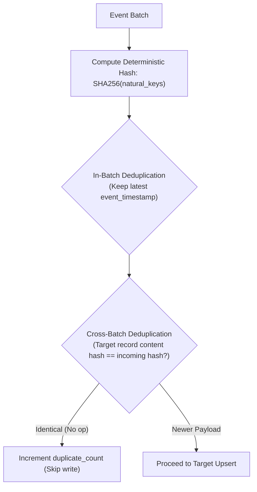
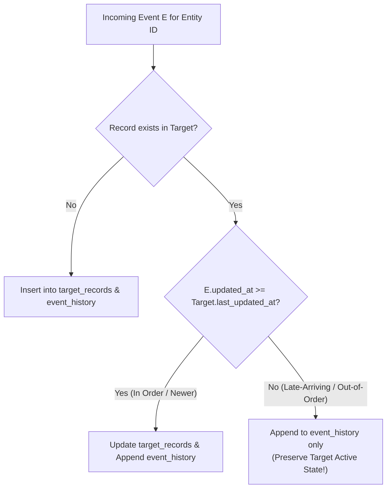

# Incremental Ingestion Framework: Architecture & System Design

## 1. High-Level Architecture Overview

The **Incremental Ingestion Framework** is an enterprise-grade, transaction-safe data engineering engine designed to reliably ingest continuous or micro-batched event streams. It guarantees:
- **Zero data loss** (via a Dead-Letter Queue / Quarantine table).
- **Exact-once semantics & idempotency** (content-addressable deterministic SHA-256 keys and audited file registry).
- **Bi-temporal consistency** (active snapshot in `target_records` + append-only audit trail in `event_history`).
- **Out-of-order and late-arriving event safety** (temporal monotonicity guards).
- **Atomic rollback and crash recovery** (all target state changes, watermark updates, and metrics committed in single ACID transactions).

---

## 2. End-to-End Pipeline Architecture Diagram

---

## 3. Dedicated Subsystem Paths

### 3.1 Rejected Records Path (Quarantine / Dead-Letter Queue)

### 3.2 Watermark & Incremental Progression Path

### 3.3 Deduplication Strategy

### 3.4 Temporal Monotonicity & Late-Arrival Recovery

### 3.5 Failure Recovery & Rollback Mechanics
- **ACID Transaction Boundaries**: All write operations for a batch—target upsert, CDC event history, quarantine logging, and watermark advancement—are executed within a single `sqlite3` transaction (`BEGIN IMMEDIATE`).
- **Crash Safety**: In case of a crash or unhandled runtime failure, `ROLLBACK` triggers automatically. No orphan target rows, partial watermarks, or desynchronized metrics can exist.
- **File Registry Checksum**: Incoming batches are registered with their SHA-256 checksum in `file_registry`. Reruns of identical files skip reprocessing unless `--force-reprocess` is explicitly passed.
