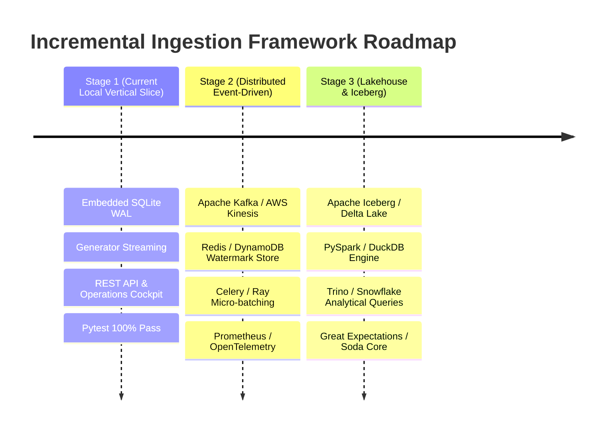

# Enterprise Roadmap & Production Scaling Strategy

This document describes how this **Incremental Ingestion Framework** scales from a local vertical slice (handling 100k+ records in SQLite WAL mode) to an enterprise-wide streaming platform handling hundreds of millions of events daily.

---

## 1. Evolution Stages

---

## 2. Key Scalability Enhancements

### 2.1 Lakehouse Storage (Apache Iceberg / Delta Lake)
- In cloud environments, target tables (`target_records`, `event_history`) transition to **Apache Iceberg tables on S3/GCS** using Parquet format with Snappy/ZSTD compression.
- Supports ACID transactions, time-travel queries, partition pruning, and metadata-driven incremental reads via Iceberg snapshot IDs.

### 2.2 Streaming Watermarking (Kafka + Redis)
- Replace file registry with **Kafka partition offset tracking** or distributed Redis sorted sets (`ZADD` with timestamps).
- Enables sub-second end-to-end event latency with sliding-window watermark horizons.

### 2.3 Automated DLQ Redrive Orchestration
- Implement automated re-drive queues where schema fixes or data corrections in the Operations Cockpit can automatically replay quarantined records without human manual intervention.

### 2.4 Distributed Query Federation
- Integrate with **Trino or DuckDB** to query both real-time SQLite/WAL snapshots and historical Iceberg archives with a unified SQL dialect.
